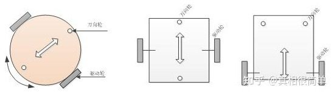
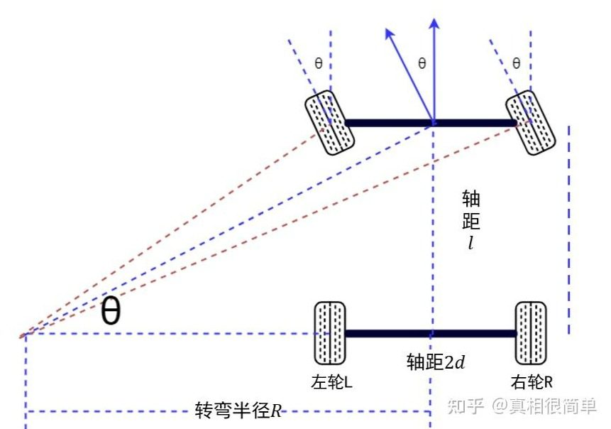
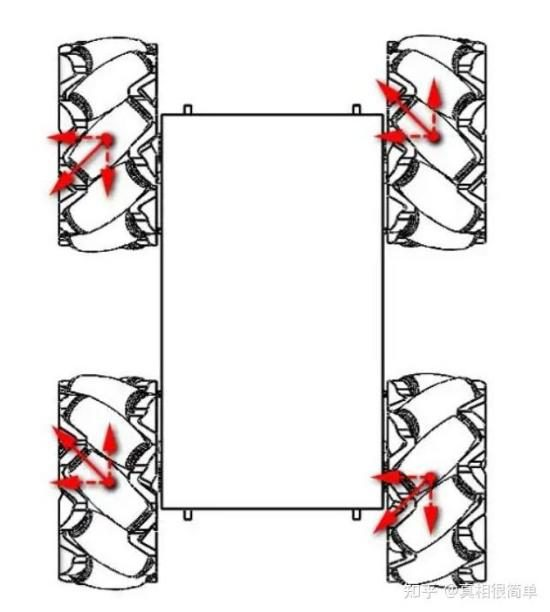
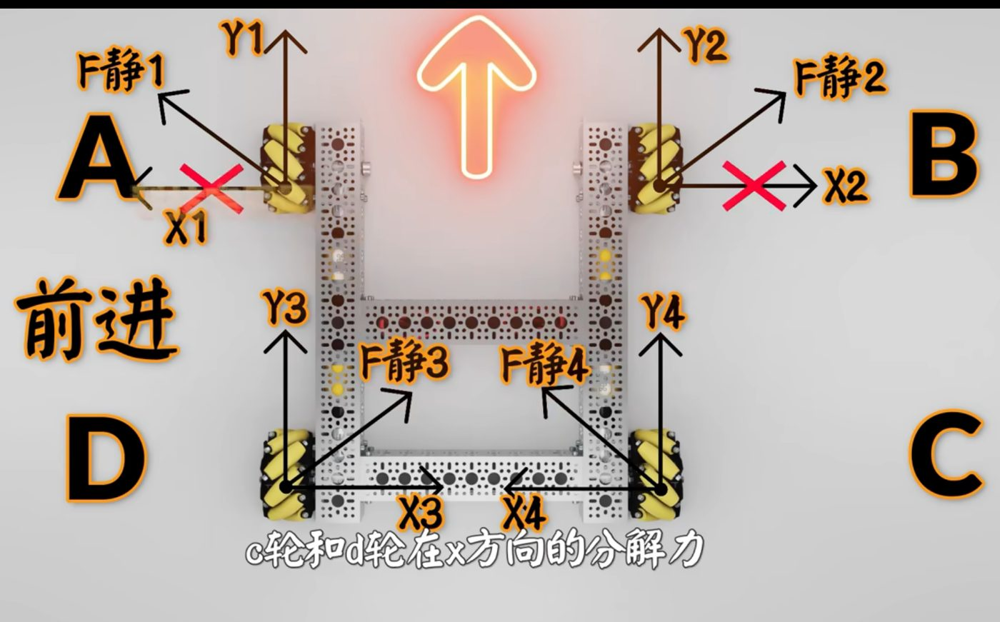
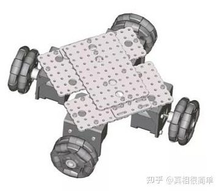
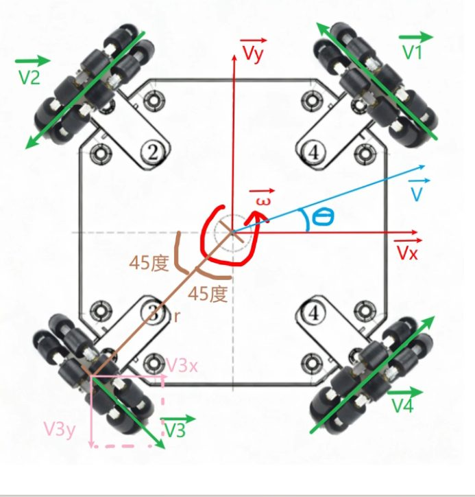
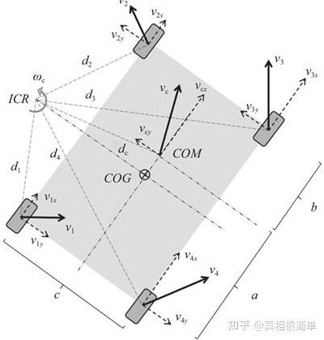

# 底盘运动学

**移动机器人常用底盘构型的结构、运动学与选型对比**

> 本文按“结构组成 → 运动学核心公式 → 运动学约束 → 典型运动模式 → 优缺点 → 工程注意事项”的统一体例，系统梳理两轮差速、四轮差速、阿克曼、全向轮（麦克纳姆轮 / 全向轮）与舵轮五类轮式底盘，给出可直接用于控制器实现的逆运动学、正运动学与位姿积分公式，并在附录提供五类底盘的横向对比与选型建议。

`移动机器人 · 底盘构型 · 运动学 · 全向底盘 · 舵轮`

---

## 概览

移动机器人底盘按行走机构可分为轮式、履带式、足式与其他特殊类型；按运动学约束则可分为非完整约束（不能沿任意方向瞬时运动）与完整约束（可全向运动）两大类。

本文按“结构组成 → 运动学核心公式 → 运动学约束 → 典型运动模式 → 优缺点 → 工程注意事项”的统一体例，依次梳理五类最常用的轮式底盘构型，并在附录给出横向对比，便于对照阅读与选型。

**表 1　常见底盘构型分类**

| 行走机构 | 典型构型 | 主要特征 |
|---|---|---|
| 轮式 | 两轮差速驱动 | 左右独立驱动，靠轮速差转向，不能横移 |
| 轮式 | 四轮差速驱动 | 四轮独立驱动，类似两轮差速但驱动力更大 |
| 轮式 | 阿克曼转向 | 汽车式，前轮转向、后轮驱动，转弯半径大 |
| 轮式 | 全向轮底盘 | 麦克纳姆轮 / 全向轮，可任意方向平移和旋转 |
| 轮式 | 舵轮底盘 | 每个轮组独立转向与驱动，灵活度最高 |
| 轮式 | 平衡车 / 两轮自平衡 | 倒立摆模型，靠动态平衡运动 |
| 履带式 | 差速履带 | 左右履带独立驱动，类似两轮差速 |
| 履带式 | 关节式履带 | 带摆臂或关节，可适应复杂地形 |
| 足式 | 双足 / 四足 / 六足八足 | 步行越障，地形适应性强、控制复杂 |
| 其他 | 轮腿复合、球形、气垫/磁悬浮 | 兼顾效率与越障，或采用非接触式运动 |

**表 2　按运动学约束分类**

| 约束类型 | 代表构型 | 能否横移 | 能否原地旋转 |
|---|---|---|---|
| 非完整约束 | 两轮差速、四轮差速、阿克曼、履带 | 不能 | 差速与履带可以，阿克曼不能 |
| 完整约束（全向） | 麦克纳姆轮、全向轮、舵轮 | 能 | 能 |

---

## 第一节　两轮差速驱动

> 两轮差速驱动是最经典的移动机器人底盘构型：左右两个驱动轮独立调速，靠速度差实现转向。它结构简单、控制成熟，也是理解其他构型运动学的起点。

<em>图 1　两轮差速底盘结构示意</em>

### 一、结构组成

典型的两轮差速底盘由以下部分组成：

- 两个驱动轮：左右各一个，分别由独立电机驱动，通常位于底盘中部轴线上。
- 万向轮 / 支撑轮：前后各一个（或只用一个），仅起支撑作用，不提供驱动力，可自由滚动和转向。
- 轮距 L：左右驱动轮中心之间的距离。
- 轮半径 r：驱动轮半径。

驱动轮只能绕自身轴线转动（不能转向），转向完全依靠左右轮的速度差实现。

### 二、运动学核心公式

#### 1. 正运动学（已知轮速 → 求底盘速度）

设左轮线速度为 vL、右轮线速度为 vR（单位 m/s），则：

V = (vR + vL) / 2 
ω = (vR − vL) / L

其中：V 为底盘中心线速度（沿车体前进方向），ω 为底盘角速度（绕垂直轴，逆时针为正），L 为轮距。

直观理解：

- 左右轮速度相同 → ω = 0，直线行驶；
- 右轮快、左轮慢 → ω &gt; 0，向左转（逆时针）；
- 左轮快、右轮慢 → ω &lt; 0，向右转（顺时针）；
- 左右轮等速反向 → V = 0，原地旋转。

#### 2. 逆运动学（已知底盘速度 → 求轮速）

VR = V + (L / 2) · ω 
VL = V − (L / 2) · ω

再由轮半径 r 换算为轮角速度：ωR = VR / r，ωL = VL / r。

#### 3. 位姿积分（航位推算）

在世界坐标系下，底盘位姿 (x, y, θ) 的连续更新为：

ẋ = V · cosθ 
ẏ = V · sinθ 
θ̇ = ω

离散化后（采样周期 Δt）：

xk+1 = xk + Vk · cosθk · Δt 
yk+1 = yk + Vk · sinθk · Δt 
θk+1 = θk + ωk · Δt

更精确的积分（考虑圆弧运动）可用中点法或精确圆弧公式。

### 三、运动学约束

#### 1. 纯滚动约束（非完整约束）

驱动轮与地面之间无滑动，轮子只能沿其朝向方向滚动。由于驱动轮不能转向（始终朝前），底盘在任意时刻的瞬时速度方向必须沿车体朝向，即：

ẏ · cosθ − ẋ · sinθ = 0

这就是非完整约束：底盘不能直接横向移动（不能沿车体侧向平移），必须通过前进 / 后退配合转向来实现任意位姿变化。

#### 2. 自由度与驱动

平面刚体有 3 个自由度（x, y, θ），但非完整约束减少了一个可独立控制的方向。实际可控输入只有 2 个（VL, VR 或 V, ω），因此两轮差速是欠驱动系统。

### 四、典型运动模式

**表 3　两轮差速的典型运动模式**

| 运动模式 | 左轮 | 右轮 | 底盘运动 | 说明 |
|---|---|---|---|---|
| 直行前进 | v | v | ω = 0 | 沿车头方向直行 |
| 直行后退 | −v | −v | ω = 0 | 反向直行 |
| 原地左转 | −v | +v | V = 0，ω > 0 | 绕两轮中点逆时针旋转 |
| 原地右转 | +v | −v | V = 0，ω < 0 | 绕两轮中点顺时针旋转 |
| 左转弯 | 慢 | 快 | ω > 0 | 边走边左转 |
| 右转弯 | 快 | 慢 | ω < 0 | 边走边右转 |

说明：原地旋转时左右轮等速反向，底盘绕两轮中心连线的中点旋转，最小转弯半径为 0，这是差速底盘相对阿克曼的核心优势。

### 五、优缺点

**优点：**

- 结构简单，成本低，易于实现；
- 可实现原地旋转（零半径转弯）；
- 运动学模型简单，控制方便；
- 对轮子类型要求低（普通橡胶轮即可）。

**缺点：**

- 不能横移（非完整约束）；
- 对轮距、轮半径的标定精度敏感，直接影响航位推算精度；
- 实际存在滑移，长时间航位推算会累积误差；
- 万向轮在高速或粗糙地面可能引入额外误差。

### 六、实际应用中的注意事项

1. 轮距标定：L 的准确值直接影响角速度计算，实际中需标定（轮胎接触点可能不在几何中心）。
2. 滑移补偿：地面摩擦不足时轮子打滑，需引入滑移率修正或融合 IMU。
3. 编码器分辨率：轮速由编码器测得，分辨率影响低速控制精度。
4. 控制接口：上层通常给 (V, ω)，底层通过逆运动学转换为左右轮 PWM / 转速指令。
5. ROS 实现：diff_drive_controller 就是标准的两轮差速控制器，订阅 cmd_vel（Twist 消息），发布轮速与里程计。

---

## 第二节　四轮差速驱动

> 四轮差速（四轮独立驱动）本质上是两轮差速的扩展：同侧两轮同速，靠左右两侧轮组的速度差转向，主要收益是更大的牵引力与更好的承载、越野能力。

### 一、结构组成

典型的四轮差速底盘由以下部分组成：

- 四个驱动轮：左前、右前、左后、右后，每个轮子由独立电机驱动；常见布置为左右两侧各两个轮，同侧两轮通常同速驱动（也可独立控制）。
- 轮距 L：左侧轮组中心到右侧轮组中心的横向距离（左右驱动轮中心距）。
- 轴距 W：前轮组中心到后轮组中心的纵向距离（前后驱动轮中心距）。
- 轮半径 r：驱动轮半径。
- 悬挂 / 支撑结构：通常需要一定悬挂或铰接结构，保证四轮同时接地，避免地面不平导致某轮悬空而失去驱动力。

驱动轮只能绕自身轴线转动（不能转向），转向完全依靠左右两侧轮组的速度差实现：同侧两轮速度相同，左右两侧形成速度差。

### 二、运动学核心公式

#### 1. 正运动学（已知轮速 → 求底盘速度）

设左侧轮组线速度为 vL（同侧两轮同速）、右侧轮组线速度为 vR，则：

V = (vR + vL) / 2 
ω = (vR − vL) / L

其中：V 为底盘中心线速度，ω 为底盘角速度（逆时针为正），L 为轮距（左右轮组中心距）。

轴距 W 不直接出现在正运动学中：同侧两轮同速时，底盘绕瞬时转向中心做圆弧运动，角速度只由左右速度差和轮距决定。轴距影响的是转弯时内外侧轮的几何关系（阿克曼效应），而纯差速滑移转向中四轮同侧同速、靠滑移完成转向。

直观理解：

- 左右轮组速度相同 → ω = 0，直线行驶；
- 右侧快、左侧慢 → ω &gt; 0，向左转（逆时针）；
- 左侧快、右侧慢 → ω &lt; 0，向右转（顺时针）；
- 左右轮组等速反向 → V = 0，原地旋转。

#### 2. 逆运动学（已知底盘速度 → 求轮速）

VR = V + (L / 2) · ω 
VL = V − (L / 2) · ω

再由轮半径 r 换算为轮角速度：ωR = VR / r，ωL = VL / r。四个轮子的指令为：左前 / 左后轮 = ωL，右前 / 右后轮 = ωR。

#### 3. 位姿积分（航位推算）

与两轮差速完全相同：

ẋ = V · cosθ 
ẏ = V · sinθ 
θ̇ = ω

离散化后（采样周期 Δt）：

xk+1 = xk + Vk · cosθk · Δt 
yk+1 = yk + Vk · sinθk · Δt 
θk+1 = θk + ωk · Δt

更精确的积分可用中点法或精确圆弧积分。

### 三、运动学约束

#### 1. 纯滚动约束（非完整约束）

与两轮差速相同：驱动轮不能转向，底盘瞬时速度方向必须沿车体朝向，即：

ẏ · cosθ − ẋ · sinθ = 0

底盘不能直接横向平移，必须通过前进 / 后退配合转向实现任意位姿。

#### 2. 四轮差速的特殊约束——滑移转向

四轮差速转向时，前后轮在同一侧同速，但内外侧轮在转弯时实际走过的弧长不同。由于轮子不能转向，转弯时轮胎必然产生横向滑移（scrub）。这是四轮差速与两轮差速的重要区别：

- 两轮差速：两个驱动轮位于底盘中部，转弯时绕中点旋转，滑移较小（另有万向轮支撑）。
- 四轮差速：四个固定朝向的轮子，转弯时前后轮轨迹半径不同，轮胎与地面之间产生纵向和横向滑移，转向阻力大、轮胎磨损快。

因此四轮差速的实际运动学比理想模型复杂：ω = (vR − vL) / L 是无滑移假设，实际角速度会因滑移而偏小，需标定修正。

#### 3. 自由度与驱动

平面刚体 3 个自由度（x, y, θ），非完整约束减少一个可独立控制方向，实际可控输入为左右两侧速度（2 个），仍是欠驱动系统。四轮独立驱动不增加可控自由度，但增加了驱动力与冗余。

### 四、典型运动模式

**表 4　四轮差速的典型运动模式**

| 运动模式 | 左侧轮组 | 右侧轮组 | 底盘运动 | 说明 |
|---|---|---|---|---|
| 直行前进 | v | v | ω = 0 | 沿车头方向直行 |
| 直行后退 | −v | −v | ω = 0 | 反向直行 |
| 原地左转 | −v | +v | V = 0，ω > 0 | 逆时针旋转 |
| 原地右转 | +v | −v | V = 0，ω < 0 | 顺时针旋转 |
| 左转弯 | 慢 | 快 | ω > 0 | 边走边左转 |
| 右转弯 | 快 | 慢 | ω < 0 | 边走边右转 |

说明：四轮差速的原地旋转能力与两轮差速相同，但需要克服更大的轮胎滑移阻力，实际原地旋转时电机负载更大、轮胎磨损更明显。

### 五、优缺点

**优点：**

- 驱动力大：四个轮子同时驱动，牵引力约为两轮差速的两倍，适合重载、爬坡、越野；
- 冗余性好：单轮失效时仍有一定驱动能力（需重新分配扭矩）；
- 接地面积大，稳定性好，适合不平地面；
- 结构相对简单，成本低于阿克曼或麦轮底盘；
- 可实现原地旋转（零半径转弯）；
- 运动学模型与两轮差速类似，控制方便。

**缺点：**

- 转弯时轮胎横向滑移大，转向阻力大、轮胎磨损快、能耗高；
- 对地面摩擦敏感，滑移导致航位推算误差比两轮差速更大；
- 需要悬挂或铰接保证四轮同时接地，结构比两轮复杂；
- 轮距、轮半径、滑移率标定更困难；
- 不能横移（非完整约束）；
- 四轮独立驱动需要四个电机和驱动器，成本与控制复杂度增加。

### 六、实际应用中的注意事项

1. 轮距标定：L 的准确值直接影响角速度计算。四轮差速转弯时滑移大，有效轮距可能偏离几何轮距，需通过原地旋转实验标定（给定左右轮速、测实际角速度、反算有效 L）。
2. 滑移补偿：四轮差速转向滑移显著，纯编码器航位推算误差累积快，建议融合 IMU（尤其陀螺仪测角速度）或视觉 / 激光里程计。可引入滑移率模型 ω实际 = k · (vR − vL) / L，标定系数 k。
3. 同侧轮速一致性：同侧前后轮应同速，但实际因轮胎磨损、地面附着差异，需做速度闭环保证一致，否则会产生额外横摆力矩。
4. 悬挂与接地：四轮必须同时接地才能发挥四驱优势，建议采用铰接底盘或独立悬挂，避免对角轮悬空。
5. 扭矩分配：四轮独立驱动可做电子差速，转弯时适当调整内外侧扭矩，减少滑移与轮胎磨损。
6. 编码器分辨率：轮速由编码器测得，分辨率影响低速控制精度，四轮需分别读取。
7. 控制接口：上层给 (V, ω)，底层通过逆运动学转换为左右组轮速，再分配给四个电机。ROS 中可用 diff_drive_controller（把同侧两轮视为一个虚拟轮）或自定义四轮控制器，订阅 cmd_vel 并发布四轮速度与里程计。
8. ROS 实现：标准 diff_drive_controller 支持多轮配置，可将左前 / 左后绑定为同一侧、右前 / 右后绑定为另一侧，轮距填左右组中心距，即可复用两轮差速的控制框架。

> **提示**　总结：四轮差速 = 两轮差速的运动学框架 + 四轮驱动的更大牵引力 + 滑移转向的额外滑移代价。理想模型与两轮差速一致，实际应用的关键在于滑移标定、四轮接地保证与扭矩分配。

---

## 第三节　阿克曼转向

> 阿克曼转向（Ackermann steering）是汽车式移动机器人底盘的经典构型：前轮转向、后轮驱动，左右前轮按阿克曼几何不等角转向，使四轮绕同一瞬心纯滚动。它转弯半径大，但高速稳定性与乘坐舒适性好，是最接近真实汽车的方案。

<em>图 2　阿克曼转向几何关系（θ 为前轮转角，R 为转弯半径）</em>

### 一、结构组成

典型的阿克曼底盘由以下部分组成：

- 两个前轮（转向轮）：左右前轮通过转向梯形机构（Ackermann linkage）连接，由转向舵机 / 电机驱动，两轮转角不等（内轮转角大于外轮），使四轮绕同一瞬时圆心运动，避免侧滑。
- 两个后轮（驱动轮）：左右后轮分别由独立电机驱动（或差速器 + 单电机），提供驱动力，不转向。
- 轴距 L：前后轴中心之间的距离。注意与两轮差速的“轮距”符号不同，此处 L 为轴距。
- 轮距 B：左右轮中心之间的距离（track width）。
- 轮半径 r：驱动轮半径。
- 转向机构：舵机 + 转向梯形，或独立转向电机（四轮独立转向构型）。

前轮只能绕垂直轴转向，后轮只能绕自身轴线转动，转向依靠前轮转角实现。

### 二、运动学核心公式

#### 1. 正运动学（已知后轮轮速与前轮转角 → 求底盘速度）

设后轮线速度为 vR（驱动轮线速度，m/s），前轮等效转角为 δ（车体坐标系下前轮中心等效转角，rad），轴距为 L，则：

V = vR 
ω = vR · tanδ / L 
R = L / tanδ

其中：V 为底盘中心线速度（近似取后轴速度），ω 为底盘角速度（逆时针为正），δ 为前轮等效转角（左转为正）。

直观理解：

- δ = 0 → ω = 0，直线行驶；
- δ &gt; 0（前轮左转）→ ω &gt; 0，向左转（逆时针）；
- δ &lt; 0（前轮右转）→ ω &lt; 0，向右转（顺时针）；
- δ 越大 → R 越小，但受机械限位约束，最小转弯半径 Rmin = L / tanδmax。

阿克曼几何下左右前轮的实际转角并不相同：

cotδo − cotδi = B / L

其中 δi 为内轮转角，δo 为外轮转角，B 为轮距。运动学计算通常采用等效转角 δ ≈ (δi + δo) / 2，或以后轴中心为参考点。

#### 2. 逆运动学（已知底盘速度 → 求后轮轮速与前轮转角）

δ = arctan(ω · L / V) 
vR = V 
ωR = vR / r

转向角由舵机执行：δcmd = δ，再经转向梯形映射到左右前轮的实际转角。

#### 3. 位姿积分（航位推算）

在世界坐标系下，底盘位姿 (x, y, θ) 的更新为：

ẋ = V · cosθ 
ẏ = V · sinθ 
θ̇ = ω = V · tanδ / L

离散化后（采样周期 Δt）：

xk+1 = xk + Vk · cosθk · Δt 
yk+1 = yk + Vk · sinθk · Δt 
θk+1 = θk + ωk · Δt

更精确的积分（考虑圆弧运动）可用中点法或自行车模型的精确圆弧解：

θk+1 = θk + ωk · Δt 
xk+1 = xk + (Vk / ωk) · (sinθk+1 − sinθk) 
yk+1 = yk − (Vk / ωk) · (cosθk+1 − cosθk)

### 三、运动学约束

#### 1. 纯滚动约束（非完整约束）

驱动轮与地面之间无滑动：后轮只沿其朝向滚动（不转向，始终朝前），前轮转向但只滚动不侧滑。以后轴中心为参考点，底盘在任意时刻的瞬时速度方向必须沿车体朝向，即：

ẏ · cosθ − ẋ · sinθ = 0

这是非完整约束：底盘不能直接横向移动，必须通过前进 / 后退配合前轮转向实现任意位姿变化。

#### 2. 阿克曼几何约束

左右前轮转角必须满足阿克曼关系，使四轮绕同一瞬时圆心，否则轮胎产生侧滑：

cotδo − cotδi = B / L

#### 3. 自由度与驱动

平面刚体有 3 个自由度（x, y, θ），非完整约束减少一个可独立控制的方向，实际可控输入只有 2 个（vR, δ 或 V, ω），因此阿克曼底盘也是欠驱动系统。与两轮差速不同的是，阿克曼不能原地旋转（δ 有限，Rmin &gt; 0），最小转弯半径受机械限位约束。

### 四、典型运动模式

**表 5　阿克曼转向的典型运动模式**

| 运动模式 | 前轮转角 δ | 后轮速度 | 底盘运动 | 说明 |
|---|---|---|---|---|
| 直行前进 | 0 | v | ω = 0 | 沿车头方向直行 |
| 直行后退 | 0 | −v | ω = 0 | 反向直行 |
| 左转弯 | δ > 0 | v | ω > 0 | R = L / tanδ |
| 右转弯 | δ < 0 | v | ω < 0 | R = L / tanδ |
| 小半径左转 | δ → δmax | v | ω 最大 | R 减小至 Rmin |
| 原地旋转 | — | — | 不可实现 | Rmin > 0，需 V ≠ 0 才能转向 |
| 倒车转弯 | δ > 0 | −v | ω < 0 | 车尾向左、车头向右，转向几何反向 |

说明：阿克曼不具备原地旋转能力，这是它相对差速与全向底盘最主要的机动性短板。

### 五、优缺点

**优点：**

- 结构接近真实汽车，驾驶行为自然，适合室外 / 道路场景；
- 前轮转向 + 后轮驱动，高速稳定性好，乘坐舒适；
- 轮胎纯滚动，滑移小，航位推算精度优于差速（尤其高速）；
- 转弯半径大但可控，适合高速大曲率路径跟踪。

**缺点：**

- 不能原地旋转（零半径转弯），最小转弯半径 Rmin 受机械限位约束；
- 不能横移（非完整约束），狭窄空间机动性差；
- 转向机构复杂（转向梯形、舵机、拉杆），成本高于差速；
- 运动学模型比差速复杂，需标定轴距、轮距与转向角映射；
- 低速大转角时轮胎仍有侧滑，阿克曼几何只能近似满足；
- 后轮独立驱动时需处理电子差速（左右后轮转速协调）。

### 六、实际应用中的注意事项

1. 轴距与轮距标定：L 和 B 的准确值直接影响角速度与阿克曼关系计算，实际中需标定（转向梯形几何、轮胎接触点）。
2. 转向角标定：舵机指令到前轮实际转角的映射是非线性的，需标定转向梯形，常用查表或拟合。
3. 电子差速：后轮独立驱动时，左右后轮转速需按转弯半径协调（内轮慢、外轮快），否则轮胎打滑。
4. 滑移补偿：高速大转角时轮胎侧滑，需引入滑移率修正或融合 IMU / GNSS。
5. 编码器分辨率：后轮轮速由编码器测得，分辨率影响低速控制精度。
6. 控制接口：上层通常给 (V, ω)，底层通过逆运动学转换为后轮转速指令与前轮转角指令（舵机 PWM / 角度）。
7. ROS 实现：ackermann_steering_controller（或 ros2_control 中的同名控制器）是标准的阿克曼控制器，订阅 cmd_vel（Twist 消息），发布后轮轮速、转向角与里程计；也可用小转角下的 diff_drive_controller 近似，但不推荐。

---

## 第四节　全向轮底盘

> 全向轮底盘（omnidirectional chassis）是实现平面全向运动的一类构型，典型代表为麦克纳姆轮（Mecanum wheel）与全向轮（Omni wheel）。

与差速、阿克曼的本质区别在于：它解除了“不能侧滑”的非完整约束，代价是轮面结构复杂、效率与地面适应性下降。其核心特征是完整约束（holonomic）：平面三个自由度（vx、vy、ω）均可独立控制，无需先转向再移动。

<table><tr><td></td><td></td></tr></table>

<em>图 3　麦克纳姆轮“X”型配置及受力方向</em>

<table><tr><td></td><td></td></tr></table>

<em>图 4　全向轮（Omni）底盘三维示意</em>

### 一、结构组成

典型的四轮全向底盘由以下部分组成：

- 四个全向轮 / 麦克纳姆轮：呈四边形排布，每个轮由独立电机驱动。
- 麦克纳姆轮：轮面周围安装一系列小滚子，滚子轴线与主轮轴线呈 45° 夹角。四个轮通常按“X”型或“O”型配置，对角轮滚子旋向相同。
- 全向轮（Omni wheel）：轮面滚子轴线与主轮轴线呈 90° 夹角。三轮构型（等边三角形排布，三点确定平面，无需悬挂）与四轮构型（需悬挂保证四轮同时着地）均常见。
- 轮半径 r：驱动轮主轮半径。
- 底盘几何参数：四轮构型中通常定义轮心到车体中心的纵向距离 lx 与横向距离 ly，用于计算旋转分量。

与差速轮不同，全向轮的主轮始终朝前，转向完全依靠各轮转速的矢量合成实现，无需任何转向机构。

### 二、运动学核心公式

以四轮麦克纳姆轮、典型“X”型配置为例。设底盘中心速度为 (vx, vy, ω)，逆时针 ω 为正；四个轮角速度记为 ω1（左前）、ω2（右前）、ω3（左后）、ω4（右后）。

**X 型配置：**从车体上方看，四个轮的滚子轴线方向两两相交，整体呈“X”形。对角轮（左前与右后、右前与左后）的滚子旋向相同、相邻轮相反。这是最常见的麦轮配置：前进时四轮同向转，横移时对角轮配合。（垂直于轮子轴线方向有一个摩擦力，垂直于滚棒方向的力为0.）

**O 型配置：**滚子轴线排布呈“O”形（相邻轮滚子旋向相同、对角轮相反），运动学矩阵的符号与 X 型不同，装错会导致横移变成斜移。

#### 1. 逆运动学（已知底盘速度 → 求轮速）

这是全向底盘控制中最常用的形式。对 45° 麦克纳姆轮，四个轮速与底盘速度的关系为：

ω1 = (1/r) · ( vx − vy − (lx + ly) · ω ) 
ω2 = (1/r) · ( vx + vy + (lx + ly) · ω ) 
ω3 = (1/r) · ( vx + vy − (lx + ly) · ω ) 
ω4 = (1/r) · ( vx − vy + (lx + ly) · ω )

其中 lx 为轮心到中心的纵向距离，ly 为横向距离。各式的正负号取决于轮子的具体安装旋向与坐标定义，实际使用中需根据“X”型或“O”型配置调整。

直观理解：

- 纯前进（vx &gt; 0，vy = 0，ω = 0）：四轮同速正转；
- 纯横移（vx = 0，vy &gt; 0）：左前 / 右后与右前 / 左后轮速反向，合力指向侧方；
- 原地旋转（vx = vy = 0，ω &gt; 0）：左前与右后反转、右前与左后正转（或反之），形成力偶。

#### 2. 正运动学（已知轮速 → 求底盘速度）

对上述关系联立求解，标准四轮麦轮配置的简化结果为：

vx = (r/4) · ( ω1 + ω2 + ω3 + ω4 ) 
vy = (r/4) · ( −ω1 + ω2 + ω3 − ω4 ) 
ω = (r / (4(lx + ly))) · ( −ω1 + ω2 − ω3 + ω4 )

符号约定随轮配置变化，以上给出的是典型形式。

#### 3. 位姿积分

由于全向底盘是完整约束系统，位姿更新比差速更直接。在世界坐标系下：

ẋ = vx · cosθ − vy · sinθ 
ẏ = vx · sinθ + vy · cosθ 
θ̇ = ω

离散化后（采样周期 Δt）：

x(k+1) = x(k) + ( vx(k) · cosθ(k) − vy(k) · sinθ(k) ) · Δt 
y(k+1) = y(k) + ( vx(k) · sinθ(k) + vy(k) · cosθ(k) ) · Δt 
θ(k+1) = θ(k) + ω(k) · Δt

与差速 / 阿克曼不同，这里不需要圆弧积分：vx、vy、ω 可以独立变化，短时间内的积分误差远小于非完整系统。

### 三、运动学约束

#### 1. 完整约束（holonomic）

全向轮通过滚子的被动侧向滚动，消除了传统轮子的不可侧滑约束。平面刚体的三个自由度（x, y, θ）全部可控，系统是完整约束系统：底盘可以在不改变朝向的情况下向任意方向平移，也可以边平移边旋转。

#### 2. 实际约束（非理想因素）

理论上的全向运动依赖一个强假设：滚子与地面之间无滑动。实际中：

- 麦克纳姆轮的 45° 滚子在侧向力作用下存在打滑，横移效率低于纵向驱动；
- 四轮构型若地面不平，部分轮可能悬空，导致运动学模型失效；四轮全向底盘通常需要悬挂或柔性连接来保证四轮同时着地；
- 滚子切换接触点时会产生振动，高速时尤为明显。

#### 3. 自由度与驱动

平面刚体 3 个自由度，四轮麦轮有 4 个驱动输入，属于冗余驱动。冗余的好处是可以优化轮速分配（如最小化打滑或能耗），但也意味着四个轮速必须协调，否则内部力冲突会加剧打滑。

### 四、典型运动模式

**表 6　四轮麦克纳姆轮（“X”型）的典型运动模式**

| 运动模式 | 左前 | 右前 | 左后 | 右后 | 结果 |
|---|---|---|---|---|---|
| 前进 | + | + | + | + | vx > 0，朝向不变 |
| 后退 | − | − | − | − | vx < 0 |
| 左横移 | − | + | + | − | vy > 0，车体不转向 |
| 右横移 | + | − | − | + | vy < 0 |
| 原地左转 | − | + | − | + | ω > 0，vx = vy = 0 |
| 原地右转 | + | − | + | − | ω < 0 |
| 斜向 45° | 0 | + | + | 0 | vx、vy 同时非零 |
| 边走边转 | 合成 | 合成 | 合成 | 合成 | 任意 (vx, vy, ω) |

全向轮（Omni）的轮速组合方式不同（滚子呈 90°），但运动能力相同：平面内任意方向平移加任意旋转。

### 五、优缺点

**优点：**

- 完整约束：可任意方向平移，狭窄空间机动性极强，适合需要精确位姿调整的场景；
- 运动学模型线性：逆运动学是简单的代数运算，控制实现比差速和阿克曼更直接；
- 可边平移边旋转：在保持朝向的同时调整位置，对对准、对接等操作任务非常有利；
- 无转向机构：不需要舵机或转向梯形，机械结构相对简洁（但轮本身复杂）。

**缺点：**

- 轮结构复杂、成本高：麦克纳姆轮和全向轮的滚子机构制造精度要求高，单价远高于普通橡胶轮；
- 效率低、打滑严重：滚子的被动滚动损失能量，横移时效率尤其低；麦克纳姆轮横移时的打滑是固有特性，航位推算精度较差；
- 对地面敏感：粗糙地面、地毯、缝隙会卡住滚子或加剧打滑。有实测表明，麦克纳姆轮在高摩擦地毯上的死区比硬地面宽 75%，且旋转存在方向不对称；
- 振动与噪音：滚子交替接触地面产生高频振动，不适合高速或高精度传感器搭载场景；
- 承载能力受限：滚子接触面积小，重载时滚子易损坏。

### 六、实际应用中的注意事项

1. 轮配置与旋向标定：麦克纳姆轮的“X”型与“O”型配置在运动学关系上不同，装错一个轮的方向会导致横移变成斜移，软件中必须正确设置每个轮的旋向符号。
2. 打滑补偿：全向底盘的航位推算精度普遍低于差速和阿克曼。实际系统中应融合 IMU（尤其是陀螺仪提供 ω）来抑制航向漂移。有研究专门针对地毯环境设计了死区补偿和多阶段目标管理，使 Nav2 在原本失败场景下达到 100% 成功率。
3. 悬挂设计：四轮全向底盘必须保证四轮同时着地，否则运动学模型完全失效。小底盘可用柔性底盘板，大底盘需要独立悬挂或摇臂机构。
4. 滚子维护：滚子轴承易积尘卡死，定期清洁和润滑是维持全向运动能力的前提。
5. 控制接口：上层通常给 (vx, vy, ω)，底层通过逆运动学转换为四个轮速指令。ROS 中可用 mecanum_drive_controller 或自定义控制器订阅 cmd_vel（Twist 消息的 linear.x、linear.y、angular.z 全部使用）。
6. 与差速的选用判断：如果场景需要频繁横移、侧向对准或在极狭窄空间调整位姿，选全向轮；如果追求续航、承载、粗糙地面适应性和里程计精度，差速或阿克曼更合适。

---

## 第五节　舵轮底盘

> 舵轮底盘（swerve drive，又称独立转向独立驱动底盘、全向舵轮底盘）是移动机器人中实现平面全向运动的另一类构型。每个轮组都是一个“舵轮模块”：一个电机负责驱动轮子前后滚动，另一个电机负责让整个轮组绕竖直轴回转，二者相互独立，因此轮子既能“朝任意方向摆”，又能“以任意速度转”。

与差速、阿克曼的本质区别：解除了“轮子必须朝向自身滚动方向”的约束，用真实转向代替几何约束，因此不再有最小转弯半径。与麦克纳姆轮、全向轮的本质区别：不依赖滚子的被动侧向滑动，轮胎始终纯滚动——麦轮靠“受控侧滑”换全向，舵轮靠“真转向 + 纯滚动”换全向。

其核心特征是完整约束（holonomic）：平面三个自由度（vx、vy、ω）独立可控，可任意方向平移、原地旋转、边平移边旋转，并能做到“车头朝向锁死、只侧向平移”；同时保留了普通橡胶轮的高效率、高承载与高里程计精度。代价是机械最复杂、成本最高、标定与控制最难。

<em>图 5　舵轮模块的速度合成与瞬时旋转中心（ICR）</em>

### 一、结构组成

典型的四轮舵轮底盘由四个完全相同的舵轮模块、一套车架与悬挂、以及整车控制器组成。单个模块的构成如下：

- 驱动链：驱动电机（低压伺服或无刷电机 + 行星减速器）→ 轮轴 → 轮子，轮半径 r。
- 转向链：转向电机（高减速比、高刚度）→ 减速器 → 回转轴 → 模块支架，带动整个轮组绕竖直轴回转。
- 回转支承：交叉滚子轴承或四点接触球轴承，同时承受轴向力、径向力与倾覆力矩。
- 角度测量：转向轴上的绝对编码器（磁编或多圈绝对值），上电即知当前转角，无需回零撞限位。
- 速度测量：驱动侧增量或绝对编码器，用于轮速闭环与里程计。
- 轮子：聚氨酯轮或橡胶轮，直径 D = 2r、宽度 b；轮面为普通圆柱面，无滚子。
- 制动：失电抱闸，防止断电后模块被地面反力“打舵”。

与差速轮不同，舵轮没有转向梯形或舵机拉杆，转向与驱动在机械上完全解耦；但也因此需要两套伺服、两套编码器，整车执行器数量 = 4 × 2 = 8。

#### 1. 模块的三种基本形式

**表 7　舵轮模块的三种基本形式**

| 形式 | 结构特点 | 运动学 | 优缺点 |
|---|---|---|---|
| 同轴式（coaxial） | 回转轴与轮心在同一竖直线上，偏移 a = 0 | 最干净：轮心速度即模块速度，θ = atan2(vy, vx) | 模型简单、精度高；但原地转向时轮胎绕自身中心扭转，刮擦与磨损明显 |
| 偏置式（offset / caster） | 轮心相对回转轴向前偏 a > 0（拖距） | 轮心绕回转轴画圆，θ 与速度隐式耦合，需迭代求解 | 相当于“主动万向轮”，减少刮擦、避开奇异；代价是标定更麻烦 |
| 差动式（double-differential） | 两个电机经差动器合成“转向 + 驱动” | 转向与驱动强耦合，需解耦映射 | 少用一个电机、成本低；但精度与响应略差，控制复杂 |

#### 2. 整机构型

- 四舵轮：最常见。四个模块布置在矩形四角（左前 FL、右前 FR、左后 RL、右后 RR），全部带转向与驱动，运动能力最完整、冗余度最高。
- 双舵轮：前后各一个舵轮模块 + 两到四个随动万向轮。成本减半，仍可实现全向，但承载与抗倾覆能力较弱。
- 单舵轮：一个舵轮 + 两个定向或万向轮（叉车式）。可以全向，但瞬时旋转中心受限、转向刮擦大，属于“准全向”。
- 菱形或十字布置：用于窄长车身或特殊外形，几何参数需重新推导。

#### 3. 几何参数

- 轮半径 r：工程上用“有效半径 reff”补偿轮胎压缩。
- 纵向距离 lx、横向距离 ly：轮心到车体中心的距离（四轮矩形布置时四个模块共用 lx、ly）。
- 模块偏移量 a：仅偏置式模块需要。
- 转向零位：模块转角为 0° 时轮子的朝向。通常统一定义为车体 +x 方向；也有厂家做成“同侧镜像”，此时左右两侧角度符号相反，软件必须对应处理。
- 转向角行程：±90°（柔性线缆 + 限位）或 ±180°、连续 360°（需滑环）。

### 二、运动学核心公式

坐标与符号约定：车体坐标 x 向前、y 向左、z 向上；vx、vy 为底盘中心速度，ω 为绕 z 轴的角速度（逆时针为正）；模块 i 的轮心位置记为 (lxi, lyi)；θi 为模块转角（相对车体 +x 轴，逆时针为正）；ωwi 为轮子角速度；r 为轮半径。

#### 1. 逆运动学（已知底盘速度 → 求各模块转角与轮速）

这是舵轮控制中最常用的形式：上层给出 (vx, vy, ω)，底层把它分解为每个模块的一个转角和一个轮速。

第一步，求模块轮心速度。轮心速度 = 底盘平动速度 + 旋转在该点产生的线速度：

vxi = vx − ω · lyi 
vyi = vy + ω · lxi

第二步，把轮心速度换算成转角与驱动速度：

θi = atan2(vyi, vxi) = atan2( vy + ω·lxi , vx − ω·lyi ) 
vi = √( vxi² + vyi² ) 
ωwi = vi / r　（轮角速度，rad/s） 
ni = 60 · vi / (2πr)　（轮转速，r/min）

注意：舵轮的逆运动学里没有矩阵乘法，只有“速度叠加 + 一次 atan2 + 一次开方”。这是它与麦轮最大的差别——麦轮靠固定的符号矩阵，舵轮靠每轮独立的几何解算。

第三步，四轮展开（lx &gt; 0、ly &gt; 0，x 向前、y 向左）：

**表 8　四轮舵轮逆运动学展开**

| 模块 | 位置 (lxi, lyi) | 轮心速度 | 转角 θi | 轮速 vi |
|---|---|---|---|---|
| 前左 FL | (lx, +ly) | (vx − ω·ly, vy + ω·lx) | atan2(vy + ω·lx, vx − ω·ly) | vFL / r |
| 前右 FR | (lx, −ly) | (vx + ω·ly, vy + ω·lx) | atan2(vy + ω·lx, vx + ω·ly) | vFR / r |
| 后左 RL | (−lx, +ly) | (vx − ω·ly, vy − ω·lx) | atan2(vy − ω·lx, vx − ω·ly) | vRL / r |
| 后右 RR | (−lx, −ly) | (vx + ω·ly, vy − ω·lx) | atan2(vy − ω·lx, vx + ω·ly) | vRR / r |

直观理解：

- 纯前进（vx &gt; 0，vy = 0，ω = 0）：四个模块都转到 0°，四轮同速正转；
- 纯横移（vx = 0，vy &gt; 0）：四个模块都转到 +90°，四轮同速正转，车头不转；
- 原地旋转（vx = vy = 0，ω &gt; 0）：四个模块分别转到 135°、45°、225°、−45°，即各自指向“以车体中心为圆心的切线方向”，四轮线速度均为 ω·√(lx² + ly²)；
- 平移 + 旋转：每个模块的转角是“平动速度”与“旋转切向速度”两个矢量的合成方向，速度是合成后的模长。

#### 2. 偏置模块（a ≠ 0）的隐式方程

偏置式模块的轮心不在回转轴上，轮心位置随转角变化：

轮心位置 = ( lxi + a·cosθi , lyi + a·sinθi )

代入速度叠加：

vxi = vx − ω · ( lyi + a·sinθi ) 
vyi = vy + ω · ( lxi + a·cosθi ) 
θi = atan2( vyi , vxi )　（隐式，θ 出现在等式两边）

工程上用不动点迭代求解，2～3 次即可收敛（偏移量 a 较小、ω 不大时）：

θ⁰ = atan2( vy + ω·lxi , vx − ω·lyi ) 
θk+1 = atan2( vy + ω·(lxi + a·cosθk) , vx − ω·(lyi + a·sinθk) )

最后用收敛后的 θ 再算一次 vi 与 ωwi 即可。

#### 3. 转角的多值性与“就近解”

atan2 的输出落在 (−180°, 180°]，而模块的实际行程可能只有 ±90°；即使行程够，直接照搬 atan2 也会让模块“绕一大圈”。处理办法是取与当前角 θcur 最接近的等价解：

θ* = θ + 180° · round( (θcur − θ) / 180° )

若 θ* 超出机械行程，则令 θ* = θ* − 180°，同时把驱动速度取反（ωwi → −ωwi）。角度加 180° 与速度取反在运动学上完全等价，但转向时间能省一半以上。

这一条对“前进 / 后退切换”“斜行方向突变”“原地旋转反向”三类指令尤其重要；不处理就会出现模块来回翻转、抖动、跟随滞后。

#### 4. 正运动学（已知模块状态 → 求底盘速度）

每个模块测得 (θi, ωwi)，先换算成轮心速度矢量：

vxi = r · ωwi · cosθi 
vyi = r · ωwi · sinθi

四个模块共给出 8 个方程，未知量只有 3 个（vx、vy、ω），属于超定方程组，用最小二乘求解：

ξ = (AᵀA)⁻¹Aᵀb，　ξ = [vx, vy, ω]ᵀ

A 的第 i 个分块（2×3）为 [ 1, 0, −lyi ; 0, 1, lxi ]，b 的第 i 个分块为 [ vxi ; vyi ]。

对矩形对称布置，AᵀA 退化为对角阵，闭式解很简洁：

vx = ( vxFL + vxFR + vxRL + vxRR ) / 4 
vy = ( vyFL + vyFR + vyRL + vyRR ) / 4 
ω = [ Σ ( lxi·vyi − lyi·vxi ) ] / ( 4(lx² + ly²) )

展开成四轮形式：

ω = [ lx·( vyFL + vyFR − vyRL − vyRR ) + ly·( vxFR + vxRR − vxFL − vxRL ) ] / ( 4(lx² + ly²) )

> **提示**　冗余的实用价值：残差 ε = b − Aξ 是一个天然的“健康指标”。残差突然变大，通常意味着某个轮打滑、编码器故障、模块转向卡死或一轮悬空，可直接用于在线诊断与降级决策。

#### 5. 位姿积分

舵轮与麦轮同为完整约束系统，位姿更新不需要圆弧积分。世界坐标系下：

ẋ = vx · cosθ − vy · sinθ 
ẏ = vx · sinθ + vy · cosθ 
θ̇ = ω

离散化后（采样周期 Δt）：

x(k+1) = x(k) + ( vx(k)·cosθ(k) − vy(k)·sinθ(k) ) · Δt 
y(k+1) = y(k) + ( vx(k)·sinθ(k) + vy(k)·cosθ(k) ) · Δt 
θ(k+1) = θ(k) + ω(k) · Δt

补充一点：舵轮的航向还能由“模块转角 + 轮速”直接解算，与陀螺仪融合后航向漂移可以做得很小，这是它里程计精度普遍优于麦轮的根本原因。

#### 6. 转向角速度校核（选型与限幅用）

模块转角的角速度需求为：

θ̇i = ( vxi · ayi − vyi · axi ) / vi²

其中 (axi, ayi) 为轮心加速度。结论是：模块越靠近瞬时旋转中心（vi 越小）、底盘加速度越大，所需转向角速度越高。因此“高速 + 大角速度 + 强加速”的组合最容易让转向电机饱和，参数选型时必须校核。

### 三、运动学约束

#### 1. 完整约束（holonomic）

传统轮子要求“轮子平面内的速度分量不能为零”（不可侧滑），这构成了非完整约束。舵轮把这个约束“主动解除”了：轮子可以转到任意方向，因此任何方向的速度都能分解到轮子的纯滚动方向上。结果是平面三个自由度全部可控：任意方向平移、原地旋转、平移与旋转同时进行，且车头朝向可以独立锁定。

#### 2. 实际约束（非理想因素）

理论上舵轮比麦轮“干净”，但实际仍有约束：

- 纯滚动假设不成立：轮胎有弹性变形，转向过程中存在轮胎扭转（scrub），转向瞬间有附加阻力与磨损；
- 速度包络有限：受驱动电机最大转速、转向电机最大角速度与加速度限制，可行的 (vx, vy, ω) 集合是一个受限多面体，而非整个平面；
- 转向时间：转角变化需要时间（典型转 90° 约 100～300 ms），高频变化的 cmd_vel 会让模块跟不上，必须做指令平滑与转角速率限制；
- 转向摩擦与磨损：原地转向时四个轮胎同时扭转，阻力矩大、磨损快，粗糙地面上更明显；
- 一轮悬空即失效：与麦轮一样，四轮必须同时着地，否则正运动学解算失真、受力异常。

#### 3. 奇异与病态位形（舵轮特有）

- 模块零速奇异：某模块轮心恰好落在瞬时旋转中心（ICR）上时 vi → 0，θi 无定义。控制上应“保持上一角度、驱动置零”，而不是输出 atan2(0, 0) 的结果。
- ICR 与回转轴重合：该模块只能原地扭转轮胎（纯刮擦），运动学上无法实现纯滚动，属于必须规避的位形。
- 共线或单侧着地：模块（或仅两轮着地）共线时，原地旋转需要轮子绕自身中心扭转，刮擦严重；同轴式布局对这类位形尤其敏感，需靠偏置轮或加大轮距规避。
- 180° 翻转位形：要求转角瞬时改变 180°（例如从“前进”直接切“后退”），转向电机来不及响应，应改用“就近解 + 驱动反向”。

需要强调：这些位形多数不是“数学无解”，而是“代价极高或物理不可达”，工程上用偏置设计、限速、就近解和指令预处理来规避。

#### 4. 自由度与驱动

平面 3 个自由度，四舵轮有 8 个执行器（4 驱动 + 4 转向），属于强冗余驱动。冗余带来四个好处：

- 关节速度优化：用加权伪逆（按各电机最大转速归一化）分配，让各模块负载均衡，避免个别模块先饱和；
- 零空间利用：停车或待命时把四个轮子摆到“零位”或“下一动作预备角度”，缩短下一次动作的转向时间；
- 故障降级：某模块失效后锁定其转角，用其余模块以“三轮全向”或“差速”模式继续行驶；
- 能耗与磨损优化：能“驱动反向”就不“转 180°”，能少转向就少转向。

### 四、典型运动模式

**表 9　四轮舵轮的典型运动模式（零位 = 车头方向，逆时针为正）**

| 运动模式 | 前左 FL | 前右 FR | 后左 RL | 后右 RR | 结果 |
|---|---|---|---|---|---|
| 前进 | 0° | 0° | 0° | 0° | vx > 0，四轮同速，车头不变 |
| 后退 | 180° | 180° | 180° | 180° | vx < 0；也可保持 0° 而驱动取反，响应更快 |
| 左横移 | +90° | +90° | +90° | +90° | vy > 0，车体不转向 |
| 右横移 | −90° | −90° | −90° | −90° | vy < 0，车体不转向 |
| 左前斜行 45° | +45° | +45° | +45° | +45° | vx、vy 同时非零 |
| 原地逆时针 | 135° | 45° | 225°（或 −135° 反驱） | −45°（或 315°） | ω > 0，四轮沿中心圆的切线方向 |
| 原地顺时针 | −45° | −135° | 45° | 135° | ω < 0，与上行镜像 |
| 原地旋转（任意中心） | 按 ICR 解算 | 按 ICR 解算 | 按 ICR 解算 | 按 ICR 解算 | 绕任意指定点旋转，需按 ICR 重新分配 |
| 边走边转 | 合成 | 合成 | 合成 | 合成 | 任意 (vx, vy, ω) |
| 停车摆正 | 0° | 0° | 0° | 0° | 收车或待命，缩短下次响应时间 |

说明：原地旋转时四个轮的线速度幅值相同（均为 ω·√(lx² + ly²)），只是方向不同，因此四个驱动电机负载一致，这是舵轮原地旋转比麦轮平稳、比差速更可控的原因。若模块行程只有 ±90°，表中 135°、225° 一类角度应取“−45° + 驱动反向”的等价解。

### 五、优缺点

**优点：**

- 真全向且纯滚动：效率、承载与续航接近普通轮底盘，明显优于麦轮；地面适应性强，不怕地毯、缝隙与轻微不平，室内外均可使用；
- 里程计精度高：无滚子被动打滑，正运动学残差小，融合 IMU 后航向漂移很小，适合高精度对接与建图定位；
- 姿态与轨迹解耦：可保持车头朝向不变而侧向平移，云台、相机、机械臂能保持稳定指向；也可先原地转到最佳角度再出发；
- 模型线性、可解释：逆运动学只是“速度叠加 + atan2 + 开方”，实现与调试都比麦轮的符号矩阵更直观；
- 冗余与容错：8 个执行器对 3 个自由度，天然支持负载优化与故障降级运行；
- 轮胎寿命长：正常行驶时轮胎纯滚动，无侧向刮擦磨损，只有转向瞬间存在扭转。

**缺点：**

- 成本最高：单个模块就要两套电机、两套编码器、减速器与回转支承，整车 BOM 与装配成本显著高于差速与麦轮方案；
- 机械最复杂：模块体积大、重心偏高、走线困难（回转轴要过线），四轮着地需要专门的悬挂或柔性设计；
- 标定繁琐：零位、有效轮径、轮距（lx、ly）、转向角非线性都要标定；零位偏差 1° 就会引起肉眼可见的横移跑偏；
- 控制难点多：就近解、转角速率限制、模块饱和、奇异规避、指令平滑都要专门处理；
- 转向摩擦与磨损：原地转向时四轮同时扭转，阻力矩大、磨损明显，因此转向电机需高扭矩、高刚度，并配抱闸；
- 高速性能受限：转向跟随误差随速度上升，通常适合中低速运行（常见 1～2 m/s，重载更低）；
- 维护点多：8 套伺服中任何一套异常都会影响整车运动，对诊断能力要求高。

### 六、实际应用中的注意事项

1. 零位标定是第一优先级。安装时用绝对编码器记录机械零位（轮子严格朝 +x），上电自检让四轮同时打到 0° 再回读，偏差超过 0.5° 即报警。零位偏差 Δθ 会让前进时混入约 V·sinΔθ 的侧向分量，表现为“直线走不直、横移跑偏”。
2. 轮径与轮距标定。直线标定：走 5 m 测实际距离，修正有效轮径 reff（含轮胎压缩）；横移标定：验证 ly 与零位的一致性；旋转标定：原地转 10 圈测实际角度，修正 lx、ly 与转向零位。建议固化为 reff、lxeff、lyeff 三个可调参数，随机型与地面分别配置。
3. 就近转向与角度解缠。在模块级统一处理：目标角与当前角之差超过 90° 时，优先取“角度 +180°、速度取反”的等价解；同时限制 |θ̇|，并对 cmd_vel 做斜坡平滑，避免模块抖动与来回翻转。
4. 四轮着地与悬挂。四舵轮若一轮悬空，正运动学会解出错误的 ω（残差变大），该轮空转还会加剧磨损。常见方案：三点支撑 + 第四点弹性（最简单）；独立悬挂或摇臂机构；用残差在线检测悬空并对该模块降权。车架刚度不足还会导致转向轴倾斜、零位漂移。
5. 转向电机与回转轴选型。扭矩要覆盖轮胎扭转阻力矩（最大，出现在原地转向）、加速惯量与侧向力引起的回正力矩；建议高减速比 + 失电抱闸，防止行驶中被地面反力“打舵”。回转轴刚度不足会直接表现为角度抖动与横移漂移。
6. 冗余分配策略。用加权伪逆按模块最大转速归一化分配，对温度高、电流大的模块降权；当 (vx, vy, ω) 组合不可行时，应按比例整体缩放（保持方向、降低速度），而不是对单个模块硬限幅——后者会让实际运动方向偏离指令方向。
7. 故障降级。单模块转向卡死或驱动失效时，可锁定该轮转角，用其余三轮求“最接近”的底盘速度（伪逆重分配）；或降级为差速模式（对侧轮锁 0°，沿对角线方向行驶）。降级策略要在软件中预先实现并做测试。
8. 走线与滑环。转角 ±90° 可用柔性线缆加机械限位；若需连续 360°（例如“转盘模式”或环形巡检），必须用滑环，否则线缆会被绞断。
9. 软件接口。上层仍下发 cmd_vel（Twist 消息的 linear.x、linear.y、angular.z 全部使用）；底层控制器完成逆运动学 → 每模块 (θcmd, vcmd) → 转向位置环 + 驱动速度环。ROS 2 可在 ros2_control 框架下自研 hardware_interface，暴露 8 个关节（4 steer + 4 drive），回读 joint_states 做正运动学并发布 odom；建议额外发布各模块的转角、轮速与残差，便于现场调试。
10. 与差速、麦轮的选型判断。需要重载（数百公斤至吨级）+ 全向 + 高精度对接或建图时选舵轮；轻载、预算有限、室内平整地面、追求机动性时选麦轮；以长距离直线行驶为主、追求续航与成本时选差速；室外高速、要求曲率连续路径时选阿克曼。

#### 常见问题排查

**表 10　舵轮底盘常见问题排查**

| 现象 | 可能原因 | 处理方向 |
|---|---|---|
| 直线走不直 | 转向零位偏差、轮径不一致、两侧轮距不对称 | 重新标定零位与 reff，检查 lx、ly |
| 横移跑偏、走成斜线 | 零位偏差、模块镜像配置与软件符号不符、偏置模块未补偿 | 核对零位定义，检查 a 与迭代求解 |
| 原地旋转漂移、绕偏心点转 | 四轮未同时着地、某轮打滑、ly 标定错误 | 检查悬挂与残差，重做旋转标定 |
| 转向抖动、嗡嗡响 | 转向环增益过高、回转轴刚度不足、指令高频跳变 | 降增益，加指令平滑与死区，检查机械间隙 |
| 模块发热、电流过大 | 转向摩擦大、抱闸未释放、轮子被卡 | 检查抱闸与轮面异物，复核转向扭矩选型 |
| 动作滞后、转弯半径变大 | 转向速率限幅过低、就近解未启用、电机饱和 | 提升限幅，加等价解处理，按比例缩放速度 |

---

## 附录　五类底盘综合对比

**表 11　五类底盘综合对比**

| 维度 | 两轮/四轮差速 | 阿克曼 | 舵轮 | 麦轮 / 全向轮 |
|---|---|---|---|---|
| 约束类型 | 非完整 | 非完整 | 完整 | 完整 |
| 任意方向平移 | 不能 | 不能 | 能 | 能 |
| 原地旋转 | 能 | 不能 | 能 | 能 |
| 最小转弯半径 | 0 | 有限值 | 0 | 0 |
| 传动效率 | 高 | 高 | 高（纯滚动） | 低（滚子侧滑损失） |
| 承载能力 | 高 | 高 | 高 | 一般（受滚子限制） |
| 地面适应性 | 好 | 好 | 好 | 差（地毯、缝隙、粗糙面） |
| 里程计精度 | 较好 | 较好 | 最好 | 较差（打滑） |
| 机械成本 | 低 | 中 | 最高 | 中 |
| 控制复杂度 | 低 | 中 | 高（标定与冗余分配） | 中 |
| 典型场景 | 仓储 AGV、服务机器人 | 室外配送、园区车 | 重载全向、精密对接、巡检 | 狭窄空间机动、竞赛机器人 |

选用时可按“机动性—效率—成本”三角权衡：窄空间频繁横移选全向类；重载 + 全向 + 高精度选舵轮；长距离直行、追求续航与成本选差速；室外高速、曲率连续路径选阿克曼。

---

## 参考资料

两轮差速部分的原始素材与配图来源：

robotics-but.github.io/BPC-PRP/3_navigation/text/1_differential_chassis.html

麦轮受力分析：https://www.bilibili.com/video/BV1sp421R7zZ?t=0.6

全向轮正逆运动速度解算：

https://www.bilibili.com/video/BV1FpnfzNEFc?t=1.8

文中配图取自网络公开资料，仅作原理示意；若需正式出版或对外发布，请替换为自有版权图。
